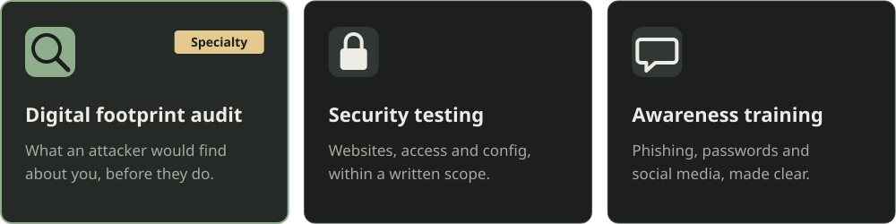
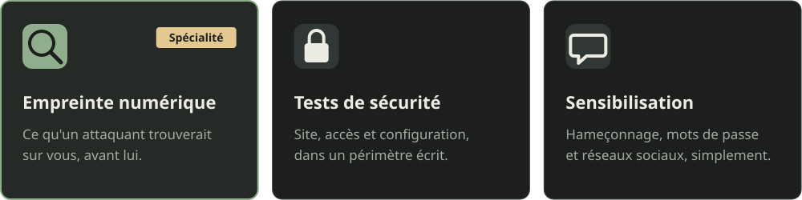

<p align="center">
  
</p>


I find what the internet knows about people and companies, before someone with worse intentions does.

My specialty is **OSINT** (open-source intelligence): rebuilding an organisation's attack surface using nothing but public sources. Leaked credentials, exposed staff, forgotten subdomains, a badge photographed on Instagram. Then I help close the gaps.


<a href="case-001/evidence.jpg"></a>

An informant sent me a single photo before going silent. Somewhere in it is the place they were watching, and somewhere else is what they wanted me to know. **Click the card to open the evidence.** Everything you need is in this repository: no social engineering, no attacking anything.

**Submit your flag**

1. Build the string `answer:your-github-username`, all lowercase.
2. Hash it with SHA-256. Your flag is unique to you, so copying someone else's won't work.
   - In your browser: [CyberChef](https://gchq.github.io/CyberChef/#recipe=SHA2('256',64,160))
   - Bash:
     ```bash
     echo -n "answer:username" | sha256sum
     ```
   - PowerShell:
     ```powershell
     $s = "answer:username"
     -join ([Security.Cryptography.SHA256]::Create().ComputeHash([Text.Encoding]::UTF8.GetBytes($s)) | % { $_.ToString("x2") })
     ```
3. [Open an issue](https://github.com/Tracevalen/Tracevalen/issues/new?title=case-001%3A%20PASTE-YOUR-HASH-HERE&body=Submitting%20my%20flag%20for%20case%20001.) with the title `case-001: <your hash>`.

A bot checks your flag within a minute. Solve it and your name goes up below.

<details>
<summary><b>Stuck? Open a hint</b></summary>
<br>

<details>
<summary>Hint 1</summary>
<br>
A photo often remembers more than it shows.
</details>

<details>
<summary>Hint 2</summary>
<br>
The informant says their notes were deleted. On GitHub, deleted rarely means gone. Look at the history.
</details>

<details>
<summary>Hint 3</summary>
<br>
Some messages are encoded, not encrypted. The trailing characters are a clue to the format.
</details>

</details>


<!-- HOF:START -->
Nobody has cracked this case yet. Be the first.
<!-- HOF:END -->





- **CTFs** with Corvus Mind, an OSINT-focused team
- **Hack The Box** and **TryHackMe**: recon, web exploitation, privilege escalation
- **Rules I work by**: no engagement without written authorisation, and collected data is deleted at the end


<p align="center">
  <a href="mailto:corvusmind@proton.me"></a>
</p>

<p align="center"><sub>French / English</sub></p>

<details>
<summary><b>Version française</b></summary>
<br>


Je trouve ce qu'Internet sait des personnes et des entreprises, avant que quelqu'un de mal intentionné ne le fasse.

Ma spécialité, c'est l'**OSINT** (renseignement en sources ouvertes) : reconstituer la surface d'attaque d'une organisation uniquement à partir d'informations publiques. Identifiants qui ont fuité, équipes exposées, sous-domaines oubliés, badge photographié sur Instagram. Ensuite, j'aide à refermer les brèches.


<a href="case-001/evidence.jpg"></a>

Un informateur m'a envoyé une seule photo avant de disparaître. Quelque part dedans se cache le lieu qu'il surveillait, et ailleurs ce qu'il voulait me dire. **Clique sur la fiche pour ouvrir la pièce à conviction.** Tout ce qu'il faut est dans ce dépôt : pas d'ingénierie sociale, aucune attaque.

**Soumettre ton flag**

1. Construis la chaîne `réponse:ton-pseudo-github`, tout en minuscules et sans accents.
2. Calcule son SHA-256. Ton flag est unique, recopier celui d'un autre ne marchera pas.
   - Dans ton navigateur : [CyberChef](https://gchq.github.io/CyberChef/#recipe=SHA2('256',64,160))
   - Bash :
     ```bash
     echo -n "reponse:pseudo" | sha256sum
     ```
   - PowerShell :
     ```powershell
     $s = "reponse:pseudo"
     -join ([Security.Cryptography.SHA256]::Create().ComputeHash([Text.Encoding]::UTF8.GetBytes($s)) | % { $_.ToString("x2") })
     ```
3. [Ouvre un issue](https://github.com/Tracevalen/Tracevalen/issues/new?title=case-001%3A%20COLLE-TON-HASH-ICI&body=Je%20soumets%20mon%20flag%20pour%20l%27affaire%20001.) avec le titre `case-001: <ton hash>`.

Un bot vérifie ton flag en moins d'une minute. Si c'est juste, ton nom apparaît dans le Hall of fame, au-dessus de cette section.

<details>
<summary><b>Bloqué ? Ouvre un indice</b></summary>
<br>

<details>
<summary>Indice 1</summary>
<br>
Une photo se souvient souvent de plus de choses qu'elle n'en montre.
</details>

<details>
<summary>Indice 2</summary>
<br>
L'informateur dit que ses notes ont été effacées. Sur GitHub, effacé ne veut pas dire disparu. Regarde l'historique.
</details>

<details>
<summary>Indice 3</summary>
<br>
Certains messages sont encodés, pas chiffrés. Les derniers caractères donnent un indice sur le format.
</details>

</details>





- **CTF** avec Corvus Mind, une équipe spécialisée en OSINT
- **Hack The Box** et **TryHackMe** : reconnaissance, exploitation web, élévation de privilèges
- **Mes règles** : aucune intervention sans autorisation écrite, et les données collectées sont supprimées à la fin


<p align="center">
  <a href="mailto:corvusmind@proton.me"></a>
</p>

</details>
